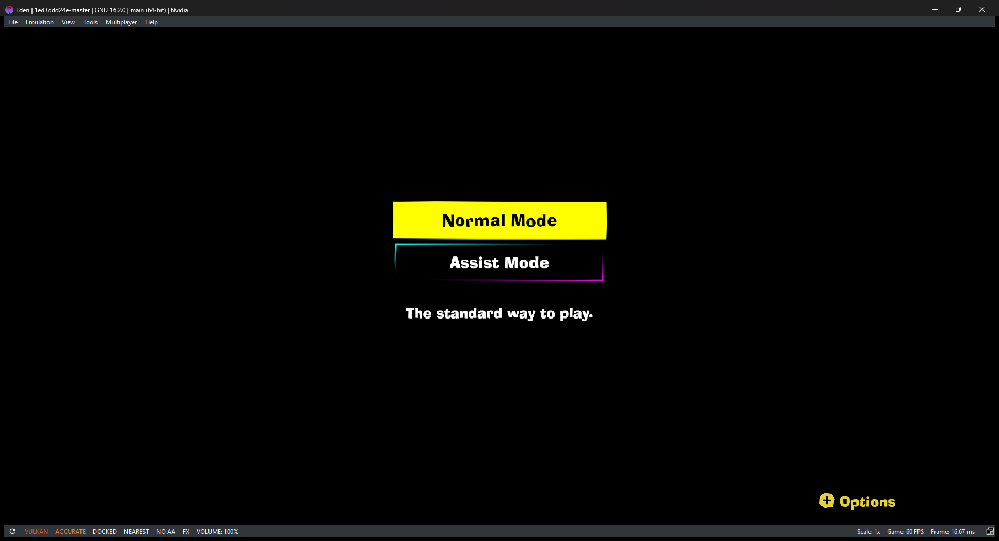

# Eden NS2 — Donkey Kong Bananza progress build

An experimental fork of the [Eden](https://git.eden-emu.dev/eden-emu/eden) Nintendo Switch emulator,
built on top of the community "Switch 2 support" patch
([ShadyHero/Eden-NS2](https://github.com/ShadyHero/Eden-NS2)), with a set of fixes that get
**Donkey Kong Bananza** (title `040074A01BF12000`, update v7.0.0) from a black screen to its
**mode-select menu at full speed (60 FPS) on Windows**.



> This is research-grade work. It is not affiliated with the Eden project or Nintendo, it does not
> include any game data, keys or firmware, and nothing here is meant for upstream as-is.
> Eden's original README is kept in [docs/README.upstream.md](docs/README.upstream.md).

## Status

| Stage | State |
| --- | --- |
| Boot, audio, GPU queues, shaders | Working |
| Mode-select menu ("Normal Mode / Assist Mode / Options") | **Working, 60 FPS, text readable** |
| Selecting Normal Mode → loading screen ("Golden Bananas?!") | Working |
| Finishing the first load | **Crashes** ~15 s into loading (see below) |

Tested on Windows 11 with an NVIDIA Turing-class GPU, in single-core and multi-core CPU modes.

### Known issue: crash during the first load

While loading the opening, one of the game's VFX (`nn::vfx2`) shader programs fails
`nvnProgramSetShaders`, because the GPU code addresses it passes are raw offsets (`0x0`, `0x3600`).
The memory pool holding that effect's shader code reports a GPU address of 0. The game then binds
uniform blocks on the uninitialised program and dereferences NULL. The next step is finding why that
pool never receives a GPU mapping. [docs/ns2/NOTES.md](docs/ns2/NOTES.md) has the full trail and the
addresses involved.

## What changed (on top of the NS2 patch)

Highlights; [docs/ns2/NOTES.md](docs/ns2/NOTES.md) lists every fix with the reasoning behind it.

- **Audio:** newer SDKs mark per-update BehaviorInfo with a different magic ("Rev" vs "REV");
  only the revision number is compared now. This removed ~600k errors per run.
- **Shader lowering (Ampere → Maxwell):** PLOP3 from any uniform predicate, TEX 3D and non-scalar
  cube-array forms, TLD4 → TLD4S, IPA with a multiplier register, generic RED, SHF right shifts,
  and the `.F16` packed-result bit on TEX/TLD/TLD4 (this was why all text drew as solid blocks).
- **Hang at ~40 s:** the compute macro data RAM was shared by every channel of a TSG, so one
  channel's QMD-ring state was clobbered and its sync object never signalled. Each compute engine
  now has its own macro interpreter state.
- **Black screen:** GPU command 214 reserves the VA ranges where the SDK places its render targets;
  they were left unbacked, so every clear and draw went nowhere. They are now backed with memory.
- **Loading:** the VFS file cache now stays below the C runtime's stream limit (MSVCRT caps it at
  2048 on MinGW builds), fixing "Too many open files" while streaming assets.
- Opt-in diagnostics (environment variables): `EDEN_NATIVE_FRAME_STATS`, `EDEN_NATIVE_TIC_TRACE`,
  `EDEN_NATIVE_HANDLE_TRACE`, `EDEN_NATIVE_SUBMIT_TRACE`, `EDEN_NATIVE_DISPLAY_OVERRIDE=<addr>`,
  `EDEN_UNMAPPED_BACKTRACE`, plus the existing `EDEN_NATIVE_FRAME_CAPTURE` / `_DRAW_DIAGNOSTICS`.

## Repository layout

This is a normal Eden source tree; the additions are:

| Path | Contents |
| --- | --- |
| `patches/eden-ns2-dkb.patch` | All changes in this repository as one diff against upstream Eden master. |
| `tools/ns2/` | Scripts used during debugging (run/capture loop, GDB remote client, breakpoint tracer, pushbuffer decoder, ...). |
| `docs/ns2/NOTES.md` | Chronological work log: every fix, why, and what was ruled out. |

## Building (Windows, MSYS2 MINGW64)

This is the route that was used; MSVC builds of the original patch also work but were not used for
these fixes.

1. Install [MSYS2](https://www.msys2.org) and, in a **MINGW64** shell, install the MinGW toolchain,
   CMake, Ninja, Qt 6, FFmpeg, SDL3, Boost, OpenSSL and the Vulkan headers, plus git and autotools
   (for example `pacman -S --needed mingw-w64-x86_64-{toolchain,cmake,ninja,qt6,ffmpeg,sdl3,boost,openssl,vulkan-headers} git autotools`;
   exact package names may differ — see [docs/Deps.md](docs/Deps.md)).
2. Configure and build from the repository root:

   ```sh
   cmake -S . -B build -G Ninja -DCMAKE_BUILD_TYPE=Release -DBUILD_TESTING=OFF -DYUZU_TESTS=OFF \
         -DENABLE_WERROR=OFF -DYUZU_ROOM=OFF -DYUZU_CMD=OFF -DENABLE_LIBUSB=OFF \
         -Denet_FORCE_BUNDLED=ON -Dlibusb_FORCE_BUNDLED=ON -DVulkanMemoryAllocator_FORCE_BUNDLED=ON
   ninja -C build yuzu
   ```

3. Copy the MinGW runtime DLLs (Qt and its dependencies) next to `build/bin/eden.exe` and add a
   `build/bin/qt.conf` containing `[Paths]` / `Plugins = plugins` (see [docs/ns2/NOTES.md](docs/ns2/NOTES.md)).

## Building (Linux)

Not tested yet, but nothing in the changes is Windows-only (the open-file limit fix is behind
`#ifdef _WIN32`), and the original NS2 patch was Linux-first.

1. Install the dependencies for your distribution; [docs/Deps.md](docs/Deps.md) has full commands for
   Arch, Debian/Ubuntu/Mint, Fedora, Gentoo and others. For example:

   ```sh
   # Arch
   sudo pacman -Syu --needed base-devel boost catch2 cmake enet ffmpeg fmt git glslang libzip lz4 ninja \
        nlohmann-json openssl opus qt6-base qt6-multimedia qt6-charts sdl3 zlib zstd zip unzip \
        vulkan-headers vulkan-utility-libraries libusb spirv-tools spirv-headers
   ```

   Debian/Ubuntu needs Ubuntu 26.04, Mint 22.3 or Debian 13 or later; the `apt-get` line is in
   [docs/Deps.md](docs/Deps.md).
2. Configure and build from the repository root:

   ```sh
   cmake -S . -B build -G Ninja -DCMAKE_BUILD_TYPE=Release -DBUILD_TESTING=OFF -DYUZU_TESTS=OFF \
         -DENABLE_WERROR=OFF
   ninja -C build yuzu
   ```

   If CMake cannot find a package your distribution doesn't ship (enet, libusb,
   VulkanMemoryAllocator, ...), add the matching `-D<name>_FORCE_BUNDLED=ON` flag from the Windows
   command above.
3. The binary is `build/bin/eden`; no DLL copying is needed.

## Running

You need your own legally dumped game, keys and firmware. The game is loaded from an extracted dump:

```sh
build/bin/eden.exe -g "<dump>/updates/458752/exefs/main"   # Windows
build/bin/eden -g "<dump>/updates/458752/exefs/main"       # Linux
```

Settings used: Vulkan, 12 GB memory layout (`memory_layout_mode=4`), GPU accuracy High.
The menu appears about 70–80 s after launch on the first run (shader cache cold).
Default keyboard: A = `C`, B = `X`, + = `M`, − = `N`, left stick = W/A/S/D.

## Credits and licence

- [Eden](https://git.eden-emu.dev/eden-emu/eden) and the yuzu/Citra projects it derives from.
- The Switch 2 support patch by ShadyHero ([Eden-NS2](https://github.com/ShadyHero/Eden-NS2)).
- Instruction encodings cross-checked against Mesa's NAK compiler (MIT).

The code is licensed like Eden: **GPL-3.0-or-later** (see [LICENSE.txt](LICENSE.txt)).
