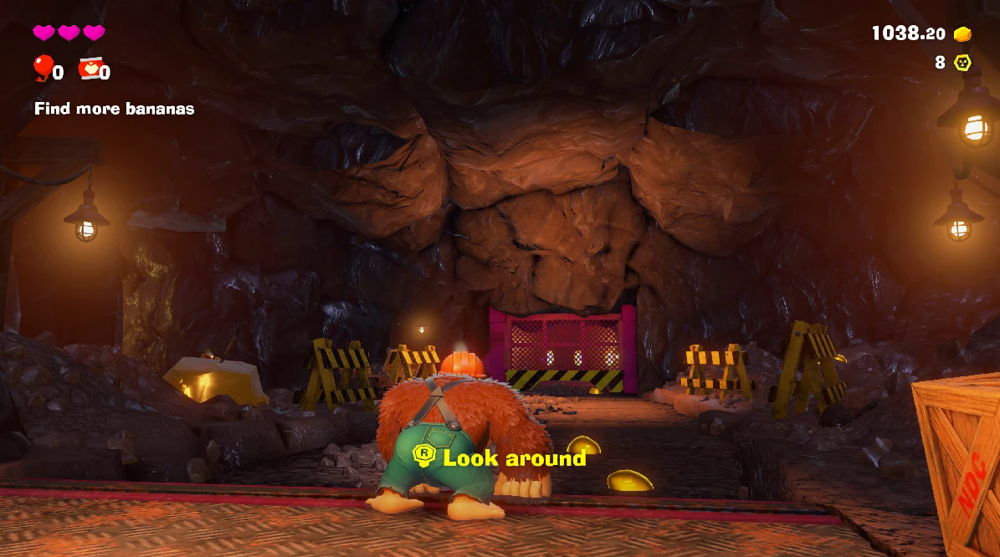
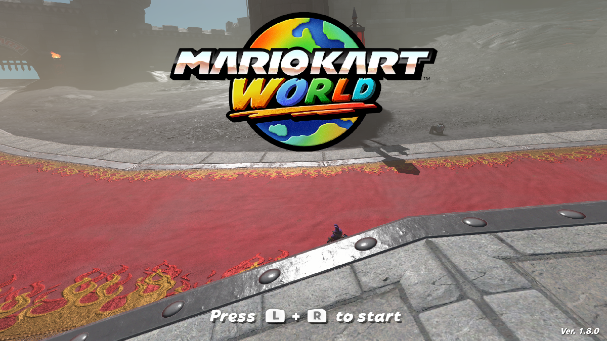
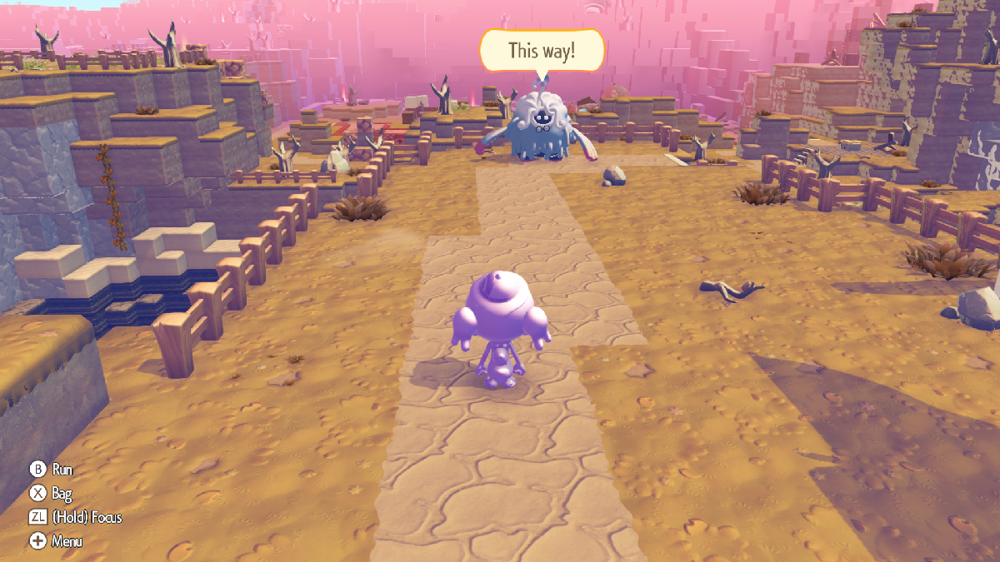

# Eden NS2

A fork of the [Eden](https://git.eden-emu.dev/eden-emu/eden) Nintendo Switch emulator that runs
Nintendo Switch 2 games.







## Status

| Game | State |
| --- | --- |
| Donkey Kong Bananza (`040074A01BF12000`, v7.0.0) | Playable |
| Mario Kart World (`0400C3F00006E000`, v1.8.0) | Playable in Free Roam and Grand Prix |
| Pokémon Pokopia (`0400A3A01EE4C000`) | Playable; stable 60 FPS |
| Splatoon Raiders (`0400380020056000`) | Playable; black screen after the intro |
| Nintendo Switch 2 Welcome Tour (`040057C02159A000`) | Boots; runs very slowly |

### Known issues

- **Performance:** still a work in progress; expect slowdowns and stutter.
- **Mario Kart World:** loading screens can take a long time, especially the first time a course is
  loaded. Recommended per-game settings: GPU accuracy Low, asynchronous shaders on, and ASTC
  recompression BC3 (needed on GPUs with less than 8 GB of video memory). Some geometry
  (task/mesh shaders) is missing.
- **Nintendo Switch 2 Welcome Tour:** reaches the intro and the tour, but runs very slowly.

## Building (Windows, MSYS2 MINGW64)

1. Install [MSYS2](https://www.msys2.org) and, in a **MINGW64** shell, install the MinGW toolchain,
   CMake, Ninja, Qt 6, FFmpeg, SDL3, Boost, OpenSSL and the Vulkan headers, plus git, patch and autotools
   (for example `pacman -S --needed mingw-w64-x86_64-{toolchain,cmake,ninja,qt6,ffmpeg,sdl3,boost,openssl,vulkan-headers} git patch autotools`;
   exact package names may differ — see [docs/Deps.md](docs/Deps.md)).
2. Configure and build from the repository root:

   ```sh
   cmake -S . -B build -G Ninja -DCMAKE_BUILD_TYPE=Release -DBUILD_TESTING=OFF -DYUZU_TESTS=OFF \
         -DENABLE_WERROR=OFF -DYUZU_ROOM=OFF -DYUZU_CMD=OFF -DENABLE_LIBUSB=OFF \
         -Denet_FORCE_BUNDLED=ON -Dlibusb_FORCE_BUNDLED=ON -DVulkanMemoryAllocator_FORCE_BUNDLED=ON
   ninja -C build yuzu
   ```

3. Copy the MinGW runtime DLLs (Qt and its dependencies) next to `build/bin/eden.exe` and add a
   `build/bin/qt.conf` containing `[Paths]` / `Plugins = plugins` (see [docs/ns2/NOTES.md](docs/ns2/NOTES.md)).

The NS2 patch's MSVC script (`build-eden-msvc.bat`) is included but has not been tried with this tree.

## Building (Linux)

Not tested yet; nothing in the changes is Windows-only.

1. Install the dependencies for your distribution; [docs/Deps.md](docs/Deps.md) has full commands for
   Arch, Debian/Ubuntu/Mint, Fedora, Gentoo and others. For example:

   ```sh
   # Arch
   sudo pacman -Syu --needed base-devel boost catch2 cmake enet ffmpeg fmt git glslang libzip lz4 ninja \
        nlohmann-json openssl opus qt6-base qt6-multimedia qt6-charts sdl3 zlib zstd zip unzip \
        vulkan-headers vulkan-utility-libraries libusb spirv-tools spirv-headers
   ```

2. Configure and build from the repository root:

   ```sh
   cmake -S . -B build -G Ninja -DCMAKE_BUILD_TYPE=Release -DBUILD_TESTING=OFF -DYUZU_TESTS=OFF \
         -DENABLE_WERROR=OFF
   ninja -C build yuzu
   ```

   If CMake cannot find a package your distribution doesn't ship (enet, libusb,
   VulkanMemoryAllocator, ...), add the matching `-D<name>_FORCE_BUNDLED=ON` flag from the Windows
   command above.
3. The binary is `build/bin/eden`; no DLL copying is needed.

## Release packages

Scripts in `tools/release/` build a release and package it. The version you give (for example `v1.0`)
is shown in the window title and used in the file names; without one the commit hash is used.

- **Windows zip**, in an MSYS2 MINGW64 shell with the packages from the Windows build section:

  ```sh
  bash tools/release/build-windows.sh v1.0
  ```

  The result is `build-release-windows/Eden-NS2-v1.0-windows-x86_64.zip`: `eden.exe` with every DLL and
  Qt plugin it needs.
- **Linux AppImage**, on Ubuntu 24.04. On Windows this works in WSL (`wsl --install -d Ubuntu-24.04`;
  clone the repository inside the Linux home folder, building under `/mnt/c` is very slow):

  ```sh
  bash tools/release/build-linux-appimage.sh --install-deps v1.0
  ```

  `--install-deps` installs the build packages with apt; Qt 6.8.3 and linuxdeploy are downloaded into
  `.cache/`. The result is `build-release-linux/Eden-NS2-v1.0-x86_64.AppImage`, for distributions with
  glibc 2.39 or newer (Ubuntu 24.04, Fedora 40, Arch and later).
- **GitHub Actions**: the "Release builds" workflow runs both scripts. Start it from the Actions tab for
  test builds, or push a tag such as `v1.0` to have both packages attached to a draft release.

## Running

Use your own dumped games, keys and firmware. Load a game from its extracted dump (the `romfs`
folder next to `exefs` is found automatically):

```sh
build/bin/eden -g "<dump>/updates/<version>/exefs/main"
```

Recommended settings: Vulkan, 12 GB memory layout, multi-core CPU.

## Licence

GPL-3.0-or-later, like Eden (see [LICENSE.txt](LICENSE.txt)). Not affiliated with the Eden project
or Nintendo; no game data, keys or firmware are included.
