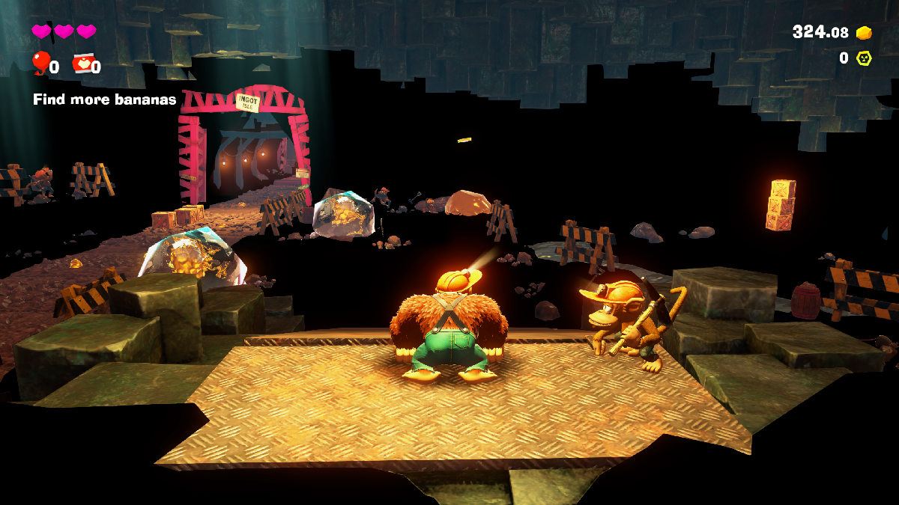

# Eden NS2 — Switch 2 progress build

An experimental fork of the [Eden](https://git.eden-emu.dev/eden-emu/eden) Nintendo Switch emulator
that runs Switch 2 games. It combines three things:

- a community "Switch 2 support" patch (the NS2 patch),
- fixes that get **Donkey Kong Bananza** (title `040074A01BF12000`, update v7.0.0) into gameplay
  with the 3D world rendering,
- the GPU and compatibility work of the **eden-nx2** fork (a separate Switch 2 fork aimed at other
  titles).




> This is research-grade work. It is not affiliated with the Eden project or Nintendo, it does not
> include any game data, keys or firmware, and nothing here is meant for upstream as-is.
> Eden's original README is kept in [docs/README.upstream.md](docs/README.upstream.md).

## Status

| Game | State |
| --- | --- |
| Donkey Kong Bananza (`040074A01BF12000`) | Boots, menus, loading and **gameplay with the 3D world rendering** |
| Pokémon Pokopia (`0400A3A01EE4C000`) | Boots to the first-run language screen (not tested further) |

Tested on Windows 11 with an NVIDIA Turing-class GPU. **Multi-core CPU mode is required**
(`use_multi_core=true`).

### Known issues

- **Donkey Kong Bananza: black patches in the destructible terrain.** Some voxel terrain chunks are
  never drawn: their vertex data is still empty when the draws happen. Shader translation, texture
  decoding and every GPU write path have been ruled out; see [docs/ns2/NOTES.md](docs/ns2/NOTES.md).
- Pokémon Pokopia has only been run as far as its first screen.
- One Bananza shader form still fails to translate; that draw is skipped.

## What is in this build

### Base: the NS2 patch

Switch 2 program loading, the graphics supervisor and GPU worker services, the NVN2 command
streams (Ampere engines, Turing macros, QMDs), a native Ampere shader frontend and an Ampere →
Maxwell shader lowering, sparse GPU regions, six emulated CPU cores, and AV1/H.264/VP9 video
decoding through FFmpeg and libgav1.

### Donkey Kong Bananza fixes

Highlights; [docs/ns2/NOTES.md](docs/ns2/NOTES.md) lists every fix with the reasoning behind it.

- **Shader lowering:** many more Ampere instruction forms (LDG/STG widths, FSET, FMNMX, F2I, IABS,
  TXQ masks, array 2D depth-compare and explicit-LOD TEX, PRMT, IMAD.X, conditional BREAK out of a
  reconvergence scope, EXIT inside a scope, uniform-register forms) and geometry shaders
  (OUT, ISBERD, invocation special registers, the LEPC prologue).
- **Storage buffers:** native storage pointers are tracked from 64-bit constant-buffer bases and
  never through values loaded from memory; up to 32 storage buffers per stage; pointer slots are
  synchronised before binding.
- **Gameplay start:** the VP9 video decoder path the game opens at gameplay start is handled.
- Opt-in diagnostics for chasing missing geometry (see below).

### From eden-nx2

- **Macro engine:** the Turing macro (MME) interpreter decodes each instruction once, repeated
  calls are replayed from a cache, and on x86-64 macros are compiled to native code
  (`EDEN_NX2_MME_JIT=0` and `EDEN_NX2_MME_MEMO=0` turn these off).
- **Macro data RAM** is per channel and shared by its 3D and compute engines, as on hardware.
- **Compute:** report-semaphore releases from the compute class, and QMD "max" releases that never
  move a counter backwards.
- **GPU thread work:** cheaper fences and cache locks (spinning recursive mutex, batched fence
  release), same-value register writes skipped (`EDEN_NX2_SKIP_SAME=0` off), fewer buffer
  copy-backs at fences (`EDEN_NX2_BUFFER_DOWNLOADS=0/1` forces), a race-free device-memory
  translation cache, and integer/pointer hashing that skips FNV on MSVC.
- **Textures:** very large virtual ASTC arrays are kept on the host from the first level that fits,
  ASTC without alpha can be recompressed to BC1 (`EDEN_NX2_ASTC_BC1=0` off), GPU BC recompression
  (`bc_encoder.comp`), and fixes for decodes racing image deletion.
- **CPU (Dynarmic):** the remaining ARMv8.1 atomics (LDSMAX/LDSMIN/LDUMAX/LDUMIN), CASP,
  pointer-authenticated branches and loads (BRAA/BLRAA/LDRAA…) and the ARMv8.5 memory-tagging
  instructions.
- **Shader lowering:** MUFU.SIN/COS now take their argument in turns as on SM70+ (they were
  computed in radians), and IMAD by a power of two lowers to a shift.
- **Kernel:** extra CPU core ids are folded onto the six emulated cores, and the guest counter
  yields while a game spins on it.

Not taken from eden-nx2: its second GPU thread (it depends on its own command-stream suspension
model) and its system-service layer (this build keeps the NS2 patch's). Its own notes are kept in
[NX2_NOTES.md](NX2_NOTES.md) and [NX2_GPU_THREAD_SPLIT.md](NX2_GPU_THREAD_SPLIT.md).

## Diagnostics

All off unless the environment variable is set:

| Variable | Effect |
| --- | --- |
| `EDEN_NATIVE_DRAW_DIAGNOSTICS`, `EDEN_NATIVE_FRAME_CAPTURE` | Draw/QMD tracing and frame captures |
| `EDEN_NATIVE_SHADER_OVERRIDE_DIR=<dir>` | With draw diagnostics: save captured native shaders for offline lowering tests |
| `EDEN_NATIVE_LOWER_DISABLE=<group,...>` | Switch individual lowering fixes off to bisect a regression |
| `EDEN_NATIVE_LOWER_GS=0` / `=1` | Geometry-stage lowering off / also tessellation |
| `EDEN_DRAW_TEXTURE_LOG` | Creating `draw-textures.request` logs the next 20000 draws with their textures, vertex streams and storage buffers |
| `EDEN_GPU_WRITE_WATCH=<va>-<va>` | Log every GPU-side write (DMA, inline upload, storage, texel buffers) into a range |
| `EDEN_POINTER_CHASE_LOG` | Log global writes whose address comes from a loaded pointer |
| `EDEN_THREAD_TRACE` | Log guest thread creation and core moves |
| `EDEN_DEBUG_CLEAR_MAGENTA` | Clear render targets to magenta to tell holes from black geometry |
| `EDEN_NX2_GPU_PROFILE` | GPU-thread zone timers |
| `EDEN_AUTO_PRESS_A=<start>,<interval>,<end>[;...]` | Tap A for unattended runs |
| `EDEN_AUTO_HOLD_PLUS=<start>,<end>[;...]` | Hold + for unattended runs |

## Repository layout

This is a normal Eden source tree; the additions are:

| Path | Contents |
| --- | --- |
| `patches/eden-ns2-dkb.patch` | All source changes in this repository as one diff against upstream Eden master. |
| `NS2.patch` | The original community Switch 2 patch this work started from. |
| `NX2_NOTES.md`, `NX2_GPU_THREAD_SPLIT.md` | The eden-nx2 fork's own work log and design notes. |
| `tools/ns2/` | Scripts used during debugging (run/capture loop, GDB remote client, breakpoint tracer, pushbuffer decoder, ...). |
| `docs/ns2/NOTES.md` | Chronological work log: every Bananza fix, why, and what was ruled out. |

## Building (Windows, MSYS2 MINGW64)

1. Install [MSYS2](https://www.msys2.org) and, in a **MINGW64** shell, install the MinGW toolchain,
   CMake, Ninja, Qt 6, FFmpeg, SDL3, Boost, OpenSSL and the Vulkan headers, plus git and autotools
   (for example `pacman -S --needed mingw-w64-x86_64-{toolchain,cmake,ninja,qt6,ffmpeg,sdl3,boost,openssl,vulkan-headers} git autotools`;
   exact package names may differ — see [docs/Deps.md](docs/Deps.md)).
2. Configure and build from the repository root:

   ```sh
   cmake -S . -B build -G Ninja -DCMAKE_BUILD_TYPE=Release -DBUILD_TESTING=OFF -DYUZU_TESTS=OFF \
         -DENABLE_WERROR=OFF -DYUZU_ROOM=OFF -DYUZU_CMD=OFF -DENABLE_LIBUSB=OFF \
         -Denet_FORCE_BUNDLED=ON -Dlibusb_FORCE_BUNDLED=ON -DVulkanMemoryAllocator_FORCE_BUNDLED=ON
   ninja -C build yuzu
   ```

3. Copy the MinGW runtime DLLs (Qt and its dependencies) next to `build/bin/eden.exe` and add a
   `build/bin/qt.conf` containing `[Paths]` / `Plugins = plugins` (see [docs/ns2/NOTES.md](docs/ns2/NOTES.md)).

The NS2 patch's MSVC script (`build-eden-msvc.bat`) is included but has not been tried with this tree.

## Building (Linux)

Not tested yet; nothing in the changes is Windows-only.

1. Install the dependencies for your distribution; [docs/Deps.md](docs/Deps.md) has full commands for
   Arch, Debian/Ubuntu/Mint, Fedora, Gentoo and others. For example:

   ```sh
   # Arch
   sudo pacman -Syu --needed base-devel boost catch2 cmake enet ffmpeg fmt git glslang libzip lz4 ninja \
        nlohmann-json openssl opus qt6-base qt6-multimedia qt6-charts sdl3 zlib zstd zip unzip \
        vulkan-headers vulkan-utility-libraries libusb spirv-tools spirv-headers
   ```

2. Configure and build from the repository root:

   ```sh
   cmake -S . -B build -G Ninja -DCMAKE_BUILD_TYPE=Release -DBUILD_TESTING=OFF -DYUZU_TESTS=OFF \
         -DENABLE_WERROR=OFF
   ninja -C build yuzu
   ```

   If CMake cannot find a package your distribution doesn't ship (enet, libusb,
   VulkanMemoryAllocator, ...), add the matching `-D<name>_FORCE_BUNDLED=ON` flag from the Windows
   command above.
3. The binary is `build/bin/eden`; no DLL copying is needed.

## Running

You need your own legally dumped games, keys and firmware. Games are loaded from an extracted dump
(the `romfs` folder next to `exefs` is picked up automatically):

```sh
build/bin/eden.exe -g "<dump>/updates/<version>/exefs/main"   # Windows
build/bin/eden -g "<dump>/updates/<version>/exefs/main"       # Linux
```

Settings used: Vulkan, 12 GB memory layout (`memory_layout_mode=4`), GPU accuracy High, multi-core
CPU (`use_multi_core=true`), reactive flushing on.
Default keyboard: A = `C`, B = `X`, + = `M`, − = `N`, left stick = W/A/S/D.

In Donkey Kong Bananza, on a save that has already picked a mode, the mode menu still appears:
press A twice to pick Normal Mode and start.

## Credits and licence

- [Eden](https://git.eden-emu.dev/eden-emu/eden) and the yuzu/Citra projects it derives from.
- The Switch 2 support patch, by an unknown author; it was originally shared on a social media
  account that has since been deleted.
- The eden-nx2 fork, for its macro engine, GPU-thread, texture and CPU work.
- Instruction encodings cross-checked against Mesa's NAK compiler (MIT); Turing macro semantics
  from Mesa's `mme_tu104` (MIT).

The code is licensed like Eden: **GPL-3.0-or-later** (see [LICENSE.txt](LICENSE.txt)).
